A Claude Code mod that picks the model for a session from its first prompt. [Laya](https://github.com/NandhaKishorM/laya) classifies the prompt on your own machine through `laya-serve`, so routing costs no tokens.

| Laya reads the prompt as… | Model | Default effort |
|---|---|---|
| trivial: quick question, translation, rename, typo, version bump | `claude-haiku-5-5` | low |
| routine: new feature, refactor, tests, script, query, email, summary | `claude-sonnet-5-5` | medium |
| hard: subtle bug, flaky test, memory leak, performance regression, architecture, migration plan, security audit | `claude-opus-5-5` | high |
| research: new theory, hypothesis, formal proof, mathematical bound | `claude-fable-5-1` (opt-in, `enableFable`; otherwise Opus) | xhigh |

## How it behaves

- **First prompt only.** Switching models mid-session drops the prompt cache, so the whole conversation is re-read at full price. The mod routes once and stays on that model. A first prompt under three words, like "hi", says too little to route, so the session stays on `/model`.
- **Skill calls are read by what they do.** A first prompt like `/implement-issue 12345` is routed once the skill expands, from the typed text plus the first 2000 characters of the skill. Where the `skill.prompt` hook isn't available (e.g. some team or organization accounts), it's routed from the typed text alone. If that text is under three words, like a bare `/commit`, the session stays on `/model`.
- **Main thread only.** Subagents keep the model their definition names.
- **Falls back to `/model`.** When Laya's confidence is below 0.475 (0.375 with Fable, since four options spread it thinner), or `laya-serve` is unreachable, requests go out unchanged.
- **`/model` wins.** Change the model by hand after routing and the mod stops overriding for the rest of the session. `/effort` alone doesn't: the mod can't read the session's effort, so it keeps sending the routed one.
- **Suggests, never switches, when a task outgrows its model.** Three failed or identical tool calls in a row, or a later prompt Laya reads as a harder tier, put `laya: tools keep failing, consider /model opus` (or `going in circles`, `this got harder`) in the status line, once per session. Later prompts are classified in the background, so they don't wait on `laya-serve`. You decide whether the switch is worth re-reading the conversation uncached.
- **Logs what happened, for calibration.** Each route (tier and confidence, or unsure/offline), nudge, manual `/model` switch (with the nudge it followed, if any), ignored nudge and session end is kept in the mod's store, the last 1000 entries. `/laya-log` prints them as JSON lines.
- **The status line shows what happened**: `laya → opus 0.87`, `laya: unsure (0.39), using /model` (or `laya: unsure, using /model` for a prompt too short to send), `laya: offline, using /model`. `/model` keeps showing the session's own model, because a mod rewrites each request and can't set the session's model.

## Install

Start `laya-serve`, e.g. with this repo's `compose.yaml`:

```bash
docker compose up -d --wait   # http://localhost:8000
```

Then, in Claude Code:

```
/plugin marketplace add marcreichel/laya-router
/plugin install laya-router@laya-router
```

Install asks for `layaUrl` (default `http://localhost:8000`) and an optional `layaApiKey`, which is sent as a Bearer token.

Fable isn't included in every subscription, so `enableFable` is off by default. While it's off, Laya chooses between Haiku, Sonnet and Opus only.

Each model's effort is a picker in `/config` (`haikuEffort`, `sonnetEffort`, `opusEffort`, `fableEffort`), from `low` to `max`. Claude Code lowers a level the model doesn't support.

## Develop

```bash
claude plugin validate .
claude plugin test .
claude --plugin-dir .
node eval/route.ts   # scores the tier descriptions against a running laya-serve (LAYA_URL)
```

The thresholds are the lowest that keep about 90% of routed prompts on the expected tier in `eval/route.ts`. Re-run it after touching `hooks/tiers.ts`.
